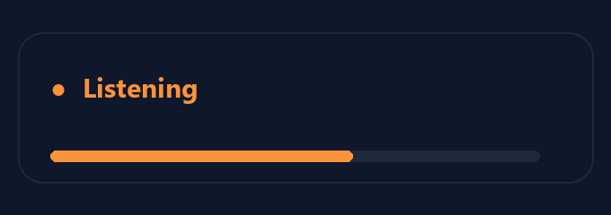

# Vibe Dictation

[](https://github.com/carrotion/vibe-dictation/actions/workflows/tests.yml)

Press a hotkey, speak one sentence, and the text appears in whatever input box
has focus — a browser, an editor, a chat app, a terminal. Transcription runs
locally with [faster-whisper](https://github.com/SYSTRAN/faster-whisper); no audio
leaves the machine and no account is needed.

```
Ctrl+Shift+D   listen once → paste at the cursor → stop
```

Press it again for the next sentence. Existing text is kept; each paste lands at
the cursor, so consecutive sentences append naturally. The app never presses
Enter or clicks anything for you: paste, edit, then submit yourself.



## What this is not

This repository is only the dictation tool. It has no chat assistant, no robot
server, no ATS/LLM integration, and no cloud services.

## Why a tray app instead of a service

A Windows service runs in session 0 and cannot see your microphone, clipboard, or
focused window. Dictation needs all three, so it is a normal user-session process
started from the Startup folder at login. There is no console window.

The only on-screen element is a small status pill drawn with a no-activate,
click-through window: it reports Listening / Transcribing / Pasted without ever
stealing focus from the app you are typing into.

## Install

Requires Windows 10/11 and Python 3.10+.

```powershell
git clone https://github.com/carrotion/vibe-dictation.git
cd vibe-dictation
py -m venv .venv
.\.venv\Scripts\python.exe -m pip install -r requirements.txt

# Create the login shortcut and start the tray app now
powershell -ExecutionPolicy Bypass -File scripts\install.ps1
```

- `-NoStart` installs the login shortcut without launching it.
- `scripts\install.ps1 -Remove` removes the shortcut.

For an NVIDIA GPU, install the CUDA runtime libraries once:

```powershell
.\.venv\Scripts\python.exe -m pip install nvidia-cublas-cu12 nvidia-cudnn-cu12
```

CUDA is tried first and CPU is used automatically on failure. `medium` is a good
default on a GPU; on CPU, `small` or `base` keeps the wait short.

## Usage

1. Click into any text field.
2. Press `Ctrl+Shift+D`. The tray icon turns orange and a small status pill
   appears at the bottom of the screen: **Listening**.
3. Speak one sentence. A pause longer than ~1.2 s ends it.
4. The pill switches to **Transcribing**, then **Pasted**, and disappears.
5. Edit if needed, then submit yourself.
6. Press the hotkey again for the next sentence.

The status pill never takes focus and ignores the mouse — clicks go through it to
whatever is underneath — so your cursor stays in the text field the whole time.
It is a status light only; there is no terminal window and no dialog to dismiss.

Pressing the hotkey while listening cancels that recording; nothing is pasted.
If no speech is detected within `wait_s`, the app turns itself off.

## Configuration

Created on first run at `%APPDATA%\vibe-dictation\config.json`; open it from the
tray menu.

```json
{
  "model": "medium",
  "device": "auto",
  "gpu_index": 0,
  "language": "ko",
  "hotwords": "",
  "input_device": "",
  "end_silence_ms": 1200,
  "wait_s": 8.0,
  "paste": true,
  "warmup": true,
  "hotkey": "ctrl+shift+d"
}
```

| Key | Meaning |
|---|---|
| `model` | `tiny`, `base`, `small`, `medium`, `large-v3`. Bigger is more accurate and slower. |
| `device` | `auto`, `cuda`, `cpu`. |
| `gpu_index` | Which GPU when several are present. |
| `language` | ISO code such as `ko`, `en`. Empty string auto-detects (slower, less stable). |
| `hotwords` | Comma-separated names or jargon to bias transcription. |
| `input_device` | Case-insensitive substring of the microphone name. Empty uses the system default. |
| `end_silence_ms` | Silence that closes the utterance. Lower feels snappier, higher tolerates thinking pauses. |
| `wait_s` | How long to wait for speech to start before giving up. |
| `paste` | `false` copies to the clipboard but never sends Ctrl+V. |
| `warmup` | Load the model at startup so the first sentence is fast. |

Hotkeys combine `ctrl`, `alt`, `shift`, `win` with a letter, digit, or `enter`,
`space`, `tab`, `backspace`, `esc`, `pause`. Restart the app after changing it.

Tray menu: status, start/cancel, open config, open log, open the Startup folder,
quit.

## Logs and state

- Log: `%LOCALAPPDATA%\vibe-dictation\logs\app.log` (rotated, 1 MB × 3)
- State: `%LOCALAPPDATA%\vibe-dictation\state.json` (status only, never the transcript)
- Single instance per user session (named mutex).

## One-shot mode

Same behaviour without the tray, useful for scripting:

```powershell
.\.venv\Scripts\python.exe -m vibe_dictation.one_shot --no-paste
```

## Tests

```powershell
.\.venv\Scripts\python.exe -m pytest
```

Tests cover config round-trips, hotkey parsing, the VAD state machine, the
record → transcribe → paste pipeline with stubbed audio and STT, and the state
file. No microphone or model download is needed.

## Limits

- Apps running as administrator can block a normal-privilege app's synthetic
  Ctrl+V (UIPI). Run the tray app elevated if you must dictate into one.
- Password fields, secure desktop prompts, and some full-screen games reject
  pasted input.
- Terminals that map `Ctrl+V` themselves may need `paste` disabled or their own
  keybinding adjusted.
- No speaker separation: other voices in the room are transcribed too.
- Audio is not stored; it lives in memory for the duration of one utterance.

## License

MIT. See [LICENSE](LICENSE).
